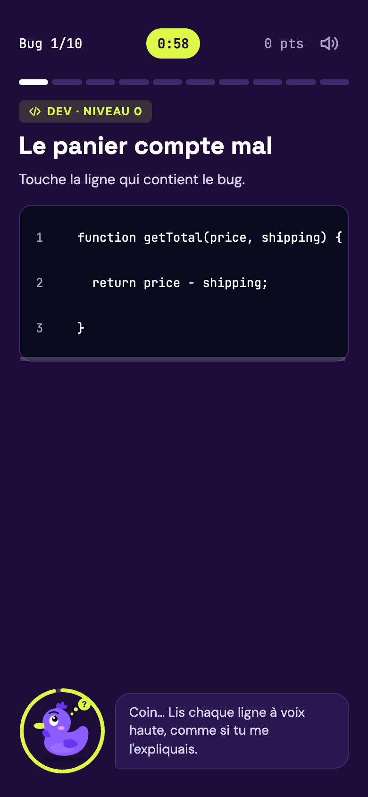
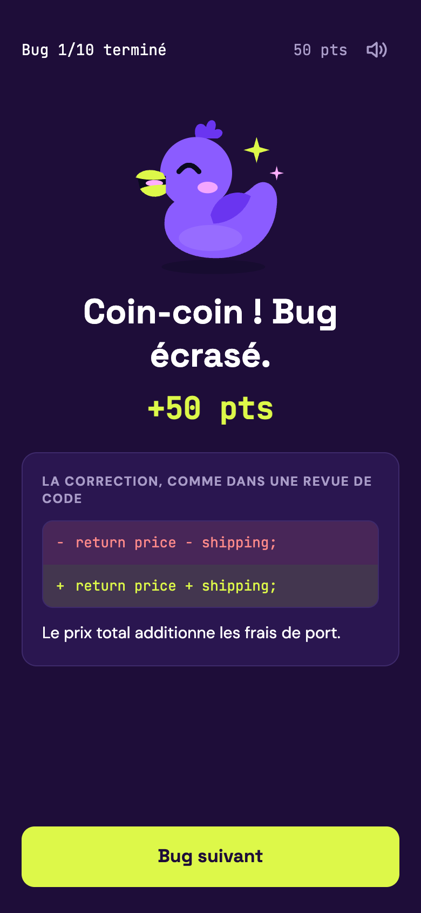
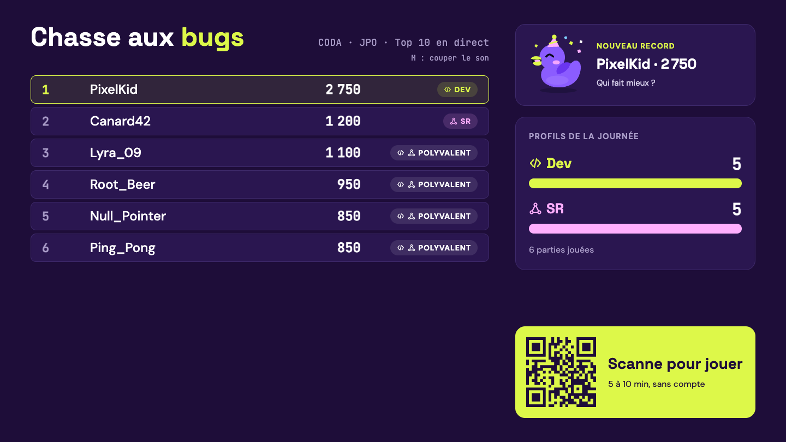

# Bug Hunt

A web game built for Coda's open day (November 7, 2026). Visitors scan a QR code,
find and fix bugs in short code snippets or network diagrams on their phone, then
discover whether they lean towards development or networking. A live leaderboard
runs on a big screen at the stand.

<p>
  
  
</p>


*Screenshots from the mock mode: the nicknames are made up.*

## How it plays

- A game is 10 bugs, 2 per level from 0 (high-school beginners) to 4, alternating
  dev and network. Each is drawn from a pool of 50 written by the team.
- 60 seconds per bug: tap the faulty line or device, then pick the right fix.
- At the end, the player sees their profile (dev, network or both) and the matching
  Coda program.
- The big screen shows the top 10, the track gauges and new records. A PIN-protected
  admin view hides nicknames and plays any bug to test it.

## Technical choices

- **The server is the only judge.** The 60-second timer, the points and the affinity
  are computed by the API. The client only displays them.
- **The answer never leaves the server early.** Public bug fields are an explicit
  list; the fix is sent only once the player has answered.
- **Front end and back end built in parallel** against a written API contract: the
  front end runs on a mock client that follows the same rules.
- **Made for phones on a stand:** no account, a game survives a page reload, sounds
  are generated with the Web Audio API (no audio file), and nothing moves with
  `prefers-reduced-motion`.
- **Tested:** 274 front-end tests (Vitest) and 235 back-end tests (PHPUnit, PHPStan
  level 6), run in CI.

> **Working on a task? Start with [CONTRIBUTING.md](CONTRIBUTING.md).**
> It explains, step by step, how each of us picks, does, reviews and merges a task.

## Team

- Charly — front end, repo, contact with the school
- Bezou — back end (API, storage, CI)
- AeRia — game content (bug JSON files)
- René (MrLeoufff) — deployment on the network track's server

Coding agents were allowed, never required: see
[Working with a coding agent](CONTRIBUTING.md#working-with-a-coding-agent).

## Stack

- Front end: React, TypeScript, Vite, Tailwind CSS (`frontend/`)
- Back end: PHP, Symfony, Doctrine, FrankenPHP, MariaDB (`backend/`)
- Game content: one JSON file per bug (`data/bugs/`)
- Docker Compose runs the API and the stand version of the game

## Run the project

Just want to play or show the game? See [Try the game](#try-the-game-windows-macos-linux) below.

Front end only, against the mock API:

```bash
cd frontend
npm ci
npm run dev        # http://localhost:5173 (players), /leaderboard (big screen), /admin
npm test -- --run  # tests
```

Phone testing, mock or real API, and how to drive the big screen with fake
players: [frontend/README.md](frontend/README.md).

The stand set-up (`docker compose up` at the root, see below) boots on the
defaults of `compose.yaml`. Before the open day, copy `.env.example` to `.env`
and change `APP_SECRET` and `ADMIN_PIN` (a long one).

The API alone, with Adminer, stays in `backend/` (`make install`, `make up`).
Stop that stack before the stand one: both want port 8000.

## Try the game (Windows, macOS, Linux)

The whole stand (game, big screen, admin, API, database) in one command. You
only need **Git** and **Docker**: no Node, no PHP, no make.

**1. Install Docker**

| System | What to install |
| --- | --- |
| Windows | [Docker Desktop](https://www.docker.com/products/docker-desktop/) (it sets up WSL 2 for you). Start it once installed. |
| macOS | [Docker Desktop](https://www.docker.com/products/docker-desktop/) (Apple chip or Intel). Start it once installed. |
| Linux | Docker Engine and the Compose plugin ([guide](https://docs.docker.com/engine/install/)), or Docker Desktop. Check with `docker compose version`. |

**2. Start it.** Same commands in PowerShell, the macOS Terminal or a Linux shell:

```bash
git clone https://github.com/coda-bug-hunt/bug-hunt.git
cd bug-hunt
docker compose up --build -d
```

The first start builds the images and takes a few minutes. Podman works too:
`podman-compose up --build -d`.

**3. Open it**

| Address | What |
| --- | --- |
| http://localhost:8080 | The game, as on a phone (on a computer: F12, then the phone icon) |
| http://localhost:8080/leaderboard | The big screen of the stand, with the QR code |
| http://localhost:8080/admin | Hide a nickname. PIN: `change-me` |

**4. Stop or update**

```bash
docker compose down                      # stop; scores are kept
docker compose down -v                   # stop and delete every score
git pull && docker compose up --build -d # get the latest version
```

### Play from your phone

1. Put the phone and the computer on the same Wi-Fi.
2. Find the IP address of the computer:
   - Windows: `ipconfig`, the IPv4 address of the Wi-Fi adapter
   - macOS: `ipconfig getifaddr en0`
   - Linux: `hostname -I`, the first address
3. On the computer, open `http://<that IP>:8080/leaderboard` (not `localhost`):
   the QR code shows the address of the page, so the phone gets one it can reach.
4. Scan the QR code with the phone and play. Your nickname shows up on the
   big screen within 2 seconds.

If the phone cannot load the page:

- **Firewall.** Windows: accept the Docker Desktop prompt, or run in an
  administrator PowerShell
  `New-NetFirewallRule -DisplayName "Bug Hunt" -Direction Inbound -LocalPort 8080 -Protocol TCP -Action Allow`.
  macOS: System Settings > Network > Firewall, allow Docker. Linux with ufw:
  `sudo ufw allow 8080/tcp`.
- **Wi-Fi.** Public and school networks often keep devices from seeing each
  other. Share the phone's connection with the computer instead.

### If it does not start

- `port is already allocated`: another program uses 8080 or 8000 (often the
  `backend/` stack: `make down` there). Or copy `.env.example` to `.env` and
  change `WEB_PORT` or `APP_PORT`.
- `docker compose ps` shows `api` as unhealthy: `docker compose logs api`
  tells why (a broken bug file, a level without bugs...).

## Where things are

- Tasks: the **Bug Hunt** board (*Projects* tab) and the issues
- Specification, mockups, meeting notes: the team's Claude Doc
